# ACE — a Sovereign Agent Compute Engine

**A sovereign Agent Compute Engine: harness, copy-on-write sandboxes, a 6502 container machine in Erlang, and a hand-rolled reverse tunnel.**


An agent compute engine that runs on hardware you own. Phone as console, Jetson (or any BEAM host) as compute, agent workspaces of the same shape. The architecture follows the split Google formalized with its Agent Compute Engine in October 2026 — a **harness** that decides and a **sandbox** that executes, separated by a hard boundary — but replaces the cloud’s policy machinery with owner-controlled mechanisms: hash-chained receipts, credential gates, and a single reverse tunnel as the only public edge.

No rented inference in the control path. No vendor tokens. No listening ports on the sandbox host. Every state change is a ledger entry. The boundary is the product.

---

## Architecture at a Glance

```mermaid
flowchart TB
    subgraph Owner["Owner's Control Plane"]
        Phone["Phone / Console"]
        Harness["Harness<br/>(Erlang/OTP)<br/>decides · dispatches · ledgers"]
        Gateway["Tunnel Gateway<br/>ace_relay<br/>(public host you control)"]
    end

    subgraph SandboxHost["Sandbox Host (Jetson / NUC / any BEAM)"]
        Agent["ace_agent<br/>(outbound only)"]
        Sbx["sbx lifecycle<br/>overlayfs workspaces"]
        Machine["ace6502<br/>6502 container CPU<br/>64 KB world"]
        Ledger[("Append-only<br/>SHA-256<br/>hash-chained ledger")]
    end

    Phone -->|JSON-lines over Unix socket| Harness
    Harness -->|sbx exec / run6502| Sbx
    Sbx --> Machine
    Harness --> Ledger
    Sbx --> Ledger
    Agent -->|outbound TCP + HMAC| Gateway
    Gateway -->|splices public traffic| Agent
    style Harness fill:#1a1a2e,stroke:#9aabba
    style Machine fill:#0c0d0f,stroke:#eceae4
    style Ledger fill:#2d2d44,stroke:#9aabba
```



The harness never executes. The sandbox never decides. The gateway is the sole public edge. Credentials never enter a sandbox tree.

---

## The Four Pieces

### `bin/sbx` — Sandbox Lifecycle

A sandbox is a copy-on-write workspace: immutable lower layers (base tree + frozen snapshots) under a writable upper, joined by overlayfs. Density comes from shared immutable bases — a thousand forks of one base store the base once.

**Verbs**

| Verb | What it does |
|------|--------------|
| `base create` | Builds an immutable base. Credential scan **refuses** trees containing `.env`, tokens, keys, or secret-shaped files. |
| `create` | Instantiates a writable sandbox over a base. |
| `exec` | Runs a command in a scrubbed environment (PATH, LANG, box name cross; nothing else). Credential-shaped `--allow` names are refused at both layers. |
| `snapshot` / `fork` / `rollback` | Native COW operations. Fork carries fork-time state then diverges; sibling writes are invisible. Rollback is total — later files are gone, not hidden. |
| `destroy` / `list` / `status` | Lifecycle and inspection. |

Every verb extends an append-only SHA-256 hash-chained ledger — the fleet’s identity and audit trail in one file.

### `harness/` — The Brain

Erlang/OTP dispatch service speaking JSON lines over a Unix socket (`$SBX_HOME/harness.sock`) per `harness/PROTOCOL.md`. It validates requests, enforces timeouts (killing the dispatched process exactly), brokers credentials at the edge, and writes the same hash-chained ledger. It never runs agent code itself.

### `machine/` — The Container CPU


A full NMOS 6502 virtual machine written in Erlang (`ace6502`), plus a term assembler (`ace_asm`) whose encodings come from the machine’s own opcode table. A sandboxed program’s world is its own 64 KB. Output is memory-mapped at `$FE00`. A deterministic step budget replaces a wall-clock. BRK is halt. BCD arithmetic and the classic indirect-jump page quirk are implemented. Runs on any hardware BEAM runs on — no KVM, no QEMU required. The harness can dispatch 6502 programs directly (`run6502`).

### `tunnel/` — The Only Public Edge

Hand-rolled reverse tunnel in the ngrok shape, pure Erlang/OTP. No vendor, no API, no account.

- `ace_agent` runs on the sandbox host and makes only outbound connections.
- `ace_relay` runs on a public host you control and splices public connections onto agent-initiated streams.
- Authentication is HMAC over a relay-issued nonce, keyed by a tunnel key you generate yourself (`tunnel/make-key.sh`) and place by hand on both hosts — the same trust shape as your SSH keys.

---

## Design Principles & Invariants

| Principle | How it is enforced |
|-----------|--------------------|
| Zero-credential guests | Credential scan on base creation; scrubbed exec environment; credential-shaped names refused at harness *and* sbx. |
| No direct network in sandbox | Unix-socket dispatch only; agent initiates outbound tunnel. |
| Per-request credential brokering | Gateway holds credentials; nothing is injected into sandbox trees or environments. |
| Attested identity | Every lifecycle event and dispatch extends the SHA-256 hash chain. A sandbox’s identity is its position in the chain. |
| True isolation | Fork divergence and total rollback are proven by the test suite, not asserted. |
| Boundary is the product | Harness never executes; sandbox never decides. Changes that blur layers require a blueprint update. |

Non-goals: rented inference or metered APIs in the control path; multi-tenant hosting for strangers. This is a sovereign engine for one owner’s fleet.

See `BLUEPRINT.md` for the full mapping of Google’s ACE pillars onto this owned-iron build.

---

## Quick Start (local verification)

```bash
# Clone and run the full suite (must all pass)
git clone https://github.com/AHMADALIPARR/ace-sovereign
cd ace-sovereign

bash test/run-tests.sh              # 18/18 — lifecycle, gates, ledger
bash tunnel/test/run-tunnel-test.sh # 7/7  — key gen, HMAC, splice
bash harness/test/run-harness-test.sh # 6/6 — protocol, timeouts, env gates
bash machine/test/run-machine-test.sh # 4/4  — 11 known-vector opcode checks
```

On hosts where overlay upper layers are restricted (certain btrfs), set `SBX_HOME` to a tmpfs. The `sbx` tool prints the hint on mount failure.

Typical flow:

```bash
# Create a clean base
./bin/sbx base create mybase /path/to/clean/tree

# Instantiate, run, snapshot, fork
./bin/sbx create box1 --base mybase
./bin/sbx exec box1 -- echo "hello from sandbox"
./bin/sbx snapshot box1 snap1
./bin/sbx fork box1 box2 --from snap1
```

The ledger lives under `$SBX_HOME` and can be recomputed end-to-end to verify the chain.

---

## Status (verified 2026-11-04)

<details>
<summary><strong>Verified by execution on the development VM</strong></summary>

- **Lifecycle & gates**: 18/18 tests — credential refusal, overlayfs visibility, scrubbed env, fork divergence in both directions, total rollback, ledger chain (9 entries).
- **6502 machine**: 4/4 tests + 11 known-vector checks (arithmetic, flags, loops, JSR/RTS, output port, budget exhaustion, BCD, indirect-jump quirk, 16-bit sum-of-squares, etc.). Protocol client 16/16.
- **Tunnel**: 7/7 — operator key generation, agent registration (HMAC), public HTTP reaching localhost harness, independent stream pairing, wrong-key refusal.
- **Harness**: 6/6 — exit codes, stdout hash, env allow/deny, credential refusal ledgered, unknown boxes refused, timeout kills, interleaved ledger (12 entries).

</details>

**Staged**: public relay deployment (choose any always-on host you control; no account or token required) and fleet-scale density runs on Jetson with additional tenants behind the tunnel.

Full details in `STATUS.md`. Claims match execution.

---

## Repository Law

From `AGENTS.md`:

1. Verify before commit — all four test suites must pass.
2. No credentials in the tree. The tunnel key is generated by the operator and lives only on the hosts.
3. The boundary is the product. Blurring layers requires a blueprint update in the same commit.
4. Claims match execution. Staged work stays staged until run.
5. The sovereign license in `LICENSE` governs this layer.

---

## License

SNAPKITTY OPAQUE SOURCE LICENSE (custom draft, AGPL-3.0 derived). Inspection, execution, study, internal research, security research, and controlled implementation are permitted. Commercial exploitation requires separate written authorization. Attribution and provenance must be preserved. See `LICENSE` for the full text.

---

*ACE is built so the machine around the weights stays yours. The harness decides. The sandbox executes. The ledger remembers. The tunnel is the only door, and you hold the key.*

**Repository**: [github.com/AHMADALIPARR/ace-sovereign](https://github.com/AHMADALIPARR/ace-sovereign)  
**Published**: 2026-11-04  
**Default branch**: `master`
